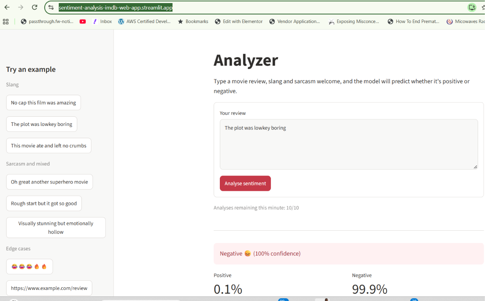
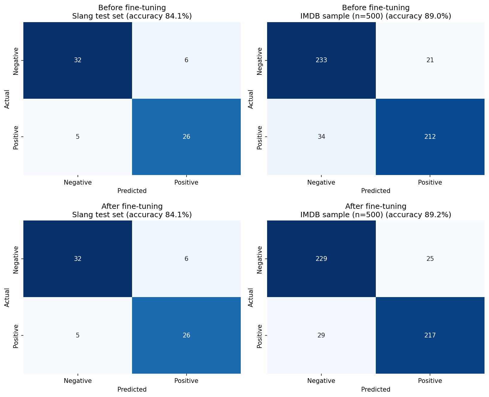

<p align="center">
  
</p>

# Sentiment Analysis of Movie Reviews (with Slang)

A sentiment classifier that labels movie reviews as positive or negative. It starts from a pre-trained Hugging Face model, evaluates it on IMDB reviews, tests how it copes with informal, slang-heavy and sarcastic reviews, fine-tunes it, and serves it in a Streamlit web app where anyone can type a review and see the prediction.

Live app: [sentiment-analysis-imdb-web-app.streamlit.app](https://sentiment-analysis-imdb-web-app.streamlit.app)\
Model on the Hub: [gatemediang/distilbert-slang-sentiment](https://huggingface.co/gatemediang/distilbert-slang-sentiment)

## Workflow

| Stage | Notebook | What it does |
|---|---|---|
| 1. Baseline evaluation | [`notebooks/sentiment_analysis.ipynb`](notebooks/sentiment_analysis.ipynb) | Scores the pre-trained model on 1,000 IMDB test reviews with accuracy, a classification report, a confusion matrix heatmap and an error analysis |
| 2. Fine-tuning and comparison | [`notebooks/imdb_sentiment_analysis_fine_tuned.ipynb`](notebooks/imdb_sentiment_analysis_fine_tuned.ipynb) | Cleans the slang dataset, fine-tunes on slang mixed with IMDB reviews, pushes the model to the Hub, and compares before and after |
| 3. Deployment | [`app.py`](app.py) | Streamlit app that loads the fine-tuned model from the Hub |

Both notebooks open directly in Google Colab from the badge at the top of each.

## Model

The base model is [distilbert-base-uncased-finetuned-sst-2-english](https://huggingface.co/distilbert-base-uncased-finetuned-sst-2-english), a 67M-parameter DistilBERT already trained for binary sentiment on SST-2. It handles standard English well but can misread slang ("this slapped", "it was mid"), sarcasm ("Oh great another superhero movie") and mixed reviews ("Rough start but it got so good").

The deployed model was fine-tuned on [`data/slang_reviews.csv`](data/slang_reviews.csv), 341 hand-labelled reviews (173 positive, 168 negative) covering Gen Z slang, internet acronyms such as GOAT, NGL and TBH, sarcasm and contrastive sentences, mixed with 800 reviews from the IMDB training set.

Training setup: 80/20 split of the slang data (272 train / 69 test, seed 42), IMDB reviews added to the training side only so the test set stays pure slang, 1,072 training examples in total, 2 epochs, batch size 16, learning rate 2e-5, 15 warmup steps, max length 256 with dynamic padding.

## Results

### Baseline (stage 1)

On 1,000 randomly sampled IMDB test reviews (512 negative, 488 positive), the pre-trained model scored 88.1% accuracy.

| Class | Precision | Recall | F1 | Support |
|---|---|---|---|---|
| Negative | 0.87 | 0.90 | 0.89 | 512 |
| Positive | 0.89 | 0.86 | 0.88 | 488 |

The confusion matrix showed a pessimistic bias: 13.9% of positive reviews were labelled negative, against 10.0% of negative reviews labelled positive. The error analysis traced many confident mistakes to reviews that open positively and turn negative, and to unusual phrasing and slang.

### Before and after fine-tuning (stage 2)

Both models were scored on the same 69 held-out slang reviews and on 500 random IMDB test reviews, which checks that learning slang didn't damage performance on ordinary reviews.

| Accuracy | Slang test (69) | IMDB sample (500) |
|---|---|---|
| Base model | 84.1% | 89.0% |
| Fine-tuned, slang only | 85.5% | 86.6% |
| Fine-tuned, slang + IMDB mix (deployed) | 84.1% | 89.2% |



On the IMDB sample, the deployed model reduced the baseline's pessimistic bias: positive reviews called negative fell from 34 to 29, and the errors are now split almost evenly between the classes (25 false positives, 29 false negatives). Precision and recall are 0.89 to 0.90 for both classes.

### What the experiments showed

The first fine-tunes trained on slang reviews alone. Slang accuracy barely moved, while IMDB accuracy fell by 2 to 3 points, and the confusion matrices showed why: positive IMDB reviews misclassified as negative rose from 34 to as many as 59. Fine-tuning had made the existing pessimistic bias worse.

Two fixes were tested. Removing sarcastic reviews whose labels can't be inferred from the text (for example "Absolutely brilliant work truly inspiring" labelled negative) did not stop the drift on its own. Mixing ordinary IMDB reviews into training did.

Fine-tuning did not improve slang accuracy beyond the base model. With 69 test reviews, one review is worth 1.4 points, so differences of one or two reviews between runs are within noise. A larger labelled slang set would be the next step.

Limitations: binary model with no neutral class (the app reports predictions under 65% confidence as uncertain), English only, small slang test set.

## The app

`app.py` loads the model from the Hugging Face Hub at startup and caches it, so no model files are stored in this repository.

Guard rails:

- Input is sanitised before validation: Unicode normalisation, control and invisible characters removed, HTML tags and links stripped, character floods ("soooooo", "!!!!!!") shortened.
- Rejected with a clear message: empty or whitespace-only text, text with no words, emoji-only text, link-only text, heavily repeated words, text over 5,000 characters.
- Accepted with a warning: reviews under three words, mostly non-Latin text (the model is English-only), reviews longer than 512 tokens (truncated, never crashing), reviews where links or emoji were removed.
- Low-confidence predictions are shown as uncertain rather than forced into a class.
- Rate limits: 10 analyses per minute per client and 120 per minute across all users, held in a shared, thread-safe limiter so refreshing the page doesn't reset them.
- Inference is serialised with a lock, since fast tokenizers aren't safe to call from several Streamlit sessions at once.
- Logs go to stdout with event types, input length and a short hash, never the review text itself.
- If the model can't be loaded, the app explains why and offers a retry instead of crashing; tracebacks are hidden from visitors (`.streamlit/config.toml`).

## Project structure

```
sentiment-analysis-imdb/
├── .streamlit/
│   └── config.toml                                Production settings (hides tracebacks, disables telemetry)
├── data/
│   └── slang_reviews.csv                          Fine-tuning dataset (341 labelled reviews)
├── images/
│   ├── confusion_matrices.png                     Before/after confusion matrix heatmaps
│   └── hero.png                                   README banner
├── notebooks/
│   ├── sentiment_analysis.ipynb                   Stage 1: baseline evaluation on IMDB
│   └── imdb_sentiment_analysis_fine_tuned.ipynb   Stage 2: fine-tuning, Hub upload, before/after evaluation
├── .gitignore
├── app.py                                         Streamlit app
├── README.md
└── requirements.txt                               App dependencies (used by Streamlit Community Cloud)
```

## Run the app locally

```bash
git clone https://github.com/gatemediang/sentiment-analysis-imdb.git
cd sentiment-analysis-imdb
python -m venv .venv
.venv\Scripts\activate        # Windows
# source .venv/bin/activate   # macOS / Linux
pip install -r requirements.txt
streamlit run app.py
```

Optional settings (environment variables or `.streamlit/secrets.toml`): `MODEL_ID`, `MODEL_REVISION` (pin a Hub commit), `HF_TOKEN` (only for a private model repo), `LOG_TO_FILE=1` (rotating log file when running locally).

## Reproduce the results

1. Open `notebooks/sentiment_analysis.ipynb` in Colab and run all cells for the baseline evaluation. It needs no login or uploads.
2. Open `notebooks/imdb_sentiment_analysis_fine_tuned.ipynb` in Colab with a GPU runtime. Add a Hugging Face token with write access as a Colab secret named `HF_TOKEN` (with notebook access switched on), change `REPO_ID` to your own Hub repo, and run the cells in order, uploading `data/slang_reviews.csv` when asked.
